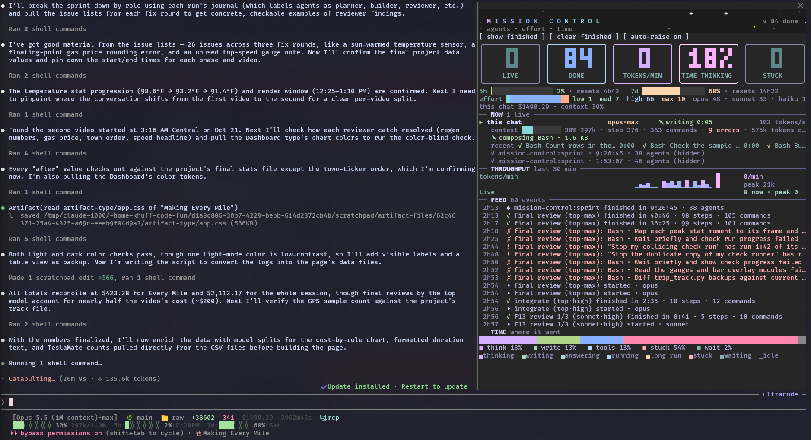

# Mission Control

A live pane for Claude Code that shows what your subagents and workflow agents are doing while they work: what each one is doing right now, at what effort, how long it has been at it, and where its time went. When a workflow runs, the top of the pane becomes a sprint dashboard with a flight plan of every ticket, a map of how the tickets depend on each other, a finish forecast, and a scrubber that replays the run.

The repo also carries the sprint workflow that Mission Control was built with and for (`workflows/sprint.js`). Much of the pane was built and fixed by that workflow running on this repo.



## Install

```sh
git clone https://github.com/kevin-huff/claude-code-mission-control ~/.claude/skills/mission-control
```

Start a new Claude Code session. `claude plugin list` should show `mission-control@skills-dir` as loaded. The pane opens by itself the first time a subagent starts in a session, and `/mission-control` opens it at any time. It adds nothing to your conversation's context.

Built and tested on Claude Code 2.1.306. Mods are an early-access part of Claude Code, so a later release may change the API underneath it.

## What the pane shows

- NOW: a card for each live agent with its model, effort, current step and running time. The heading counts any that look stuck.
- SUBAGENTS: ordinary subagents from the last 30 minutes, one line each.
- RUN and WORKING: each workflow run, and the lanes it has in progress.
- THROUGHPUT and TIME: tokens per minute over the last 30 minutes, and a bar of where the time went.
- FEED: events as they happen. Agents starting, commands failing, tickets passing or failing review, plans landing, final verdicts.

While a workflow sprint runs, and for five minutes after it ends, the top of the pane follows it:

- A headline in plain words, for example `Waiting on F3 (sonnet·high, 4:10 in) · 2 tickets behind it · 5 of 9 passed · about 12 min left`.
- Tiles for tickets passed, minutes left, working, waiting, retries and tokens out.
- SPRINT MAP: the tickets, their dependencies and the longest chain.
- FLIGHT PLAN: one row per ticket, with its builds and reviews drawn on a time axis that runs out to the forecast finish.
- Your 5-hour usage limit, now and where it will be when the sprint ends (see below).
- A scrubber under the flight plan. Click or drag to replay any moment of a running or finished sprint. The layout stays put while you scrub.

If a subagent fails two commands in a row, Mission Control raises its effort one level for its next request (never past max) and says so in the feed. Press `e` to turn that off.

## Keys

| Key | What it does |
|---|---|
| `b` / `n` | Step back or forward through a sprint |
| `l` | Back to live |
| `f` | Show or hide finished sprints |
| `c` | Clear finished sprints |
| `e` | Auto-raise on or off |
| `m` | Leave an agent's detail view |

In the scrubber, the left and right arrows step through the run, and `l`, Enter or End go back to live.

## The 5-hour limit line

Mission Control reads your usage from the JSON that Claude Code hands your status line command. It looks for a copy at `/tmp/.claude-statusline-last.json`, so save one from your status line script:

```sh
input=$(cat)
echo "$input" > /tmp/.claude-statusline-last.json
# ...the rest of your status line
```

Without that file everything else works; the limit line just doesn't show.

## The sprint workflow

`workflows/sprint.js` runs build or change work as a sprint through Claude Code's Workflow tool. A top-tier planner cuts the work into small tickets, fast models build them, a stronger model reviews each one, and a ticket that fails review retries one tier up in its own lane. A final review at max effort sorts what it finds into blocking problems and polish, and only blocking problems start a fix round.

Install it for your user:

```sh
mkdir -p ~/.claude/workflows
cp ~/.claude/skills/mission-control/workflows/sprint.js ~/.claude/workflows/
```

Claude Code reads saved workflows when a session starts, so open a new session, then ask for it by name ("use the sprint workflow to ..."). Arguments:

- `goal` (required), `context`, and `checks`: commands that prove the change works, one per line.
- `issues`: a list of known problems. Skips the planner and goes straight to fix tickets.
- `maxTickets` (default 16), `fixRounds` (default 1, at most 3), `reviewers` (1 to 3 parallel final reviewers), `cap` (a token cap for the sprint).

Each lane runs in its own `parallel()` slot, so resuming a stopped run with the Workflow tool's `resumeFromRunId` reuses every finished step. Sprints run a lot of agents (15 to 52 in the runs it was tested on) and spend tokens to match.

## Development

```sh
claude plugin validate .
claude plugin test .                                  # the whole suite; it takes a folder, not a file
node workflows/sprint.test.mjs workflows/sprint.js    # workflow scenarios A to V
npx -y -p typescript@5.6.3 tsc -p .
```

The type check needs `.claude-plugin/types/`, which Claude Code writes the first time a session loads the mod, so start a session once after cloning.

## License

Unlicense (public domain). See `LICENSE`.
